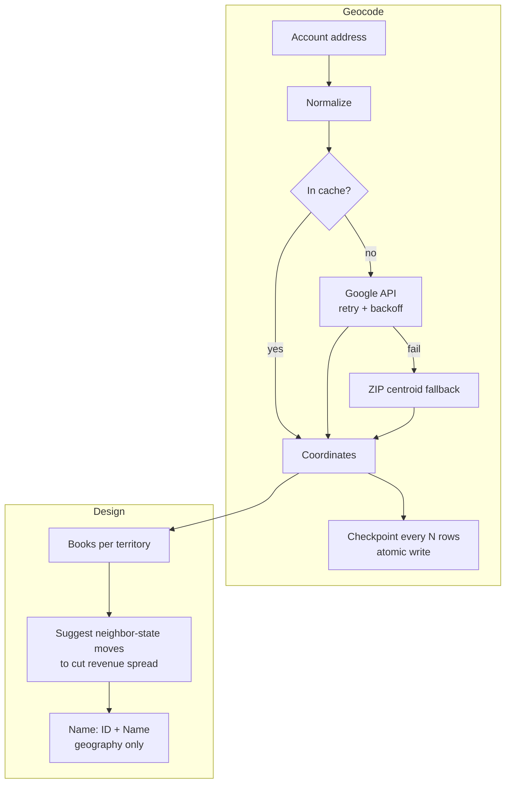

# Territory Optimizer

[](https://github.com/vrutikadani/territory-optimizer/actions/workflows/ci.yml)

A toolkit for designing sales territories: geocoding that survives failures, a naming convention that survives staffing changes, and a balance check that suggests fair state moves. The routing rules that use these territories live in [hubspot-revops-system](https://github.com/vrutikadani/hubspot-revops-system).

> **About this repo.** Clean-room reference implementation using synthetic data, inspired by territory work I did; not employer source code. All accounts, reps and territories here are synthetic.

## The business problem

- Territory labels had rep names baked in ("Temp JORDAN"), so every hire or exit broke reports and workflows.
- Some reps carried far bigger books than others.
- A geocoding job failed halfway through the account list. It had no cache and no checkpoint, so a restart meant paying for every address again, and partial results overwrote good data.

## What's inside



| Module | What it does |
|---|---|
| `territory/geocode.py` | Cache, retry with backoff on rate limits, timeouts and dropped connections, checkpoints plus a flush on exit or error, atomic writes, ZIP fallback, never overwrite good data |
| `territory/naming.py` | Builds `ID` ("MS, AL, Memphis, Atlanta") and `Name` ("Mississippi, Alabama, Memphis, Atlanta"); lints old labels for rep names, "temp" and airport codes |
| `territory/balance.py` | Revenue and account counts per territory, plus an `unassigned` bucket for accounts in states no territory owns; greedy neighbor-state moves that shrink the max/min spread |

## Run it

```bash
pip install pytest
python run_demo.py       # geocoding, naming and balance on synthetic data
python -m pytest -q      # 26 tests
```

Sample balance output:

```
Balance - spread before: 1.75x
   move TN Southeast -> South Central: spread 1.75x -> 1.55x
   move WA Pacific -> Mountain: spread 1.55x -> 1.29x
   move AL Southeast -> South Central: spread 1.29x -> 1.2x
```

Live geocoding (optional): set `GOOGLE_MAPS_KEY` and use `GoogleProvider` with `CachedGeocoder`.

How failures are handled:

- `OVER_QUERY_LIMIT`, `UNKNOWN_ERROR`, timeouts and connection errors are retried with backoff. If retries run out, the run keeps going.
- After a transient failure, a ZIP-centroid fallback is cached with `retry: true`. The street address is tried again next time.
- `ZERO_RESULTS` is cached as `not_found`, so a bad address is not paid for twice.
- `REQUEST_DENIED` (for example a bad key) stops the run. `geocode_many` and `with CachedGeocoder(...)` flush the cache first.
- Precision comes from Google's `location_type` (`rooftop`, `range_interpolated`, `geometric_center`, `approximate`), or `zip_centroid` for the fallback.
- The ZIP is read from the end of the address, so a house number like `12345 Main St` is not read as a ZIP.

## Limitations

- Moves only check that the moved state borders the destination. A move can leave the source territory split in two. A full contiguity check is not built.
- The neighbor map covers only the states used in the demo.
- Balance uses revenue only. It ignores drive time, account count and rep capacity.

## Lessons from the geocoding failure

- **Cache first.** An address should cost one API call, ever.
- **Checkpoint.** A crash should lose minutes, not the whole run.
- **Never overwrite good data with a failure.**
- **Say how precise a point is.** A ZIP centroid is fine for territory design, not for drive-time routing.

