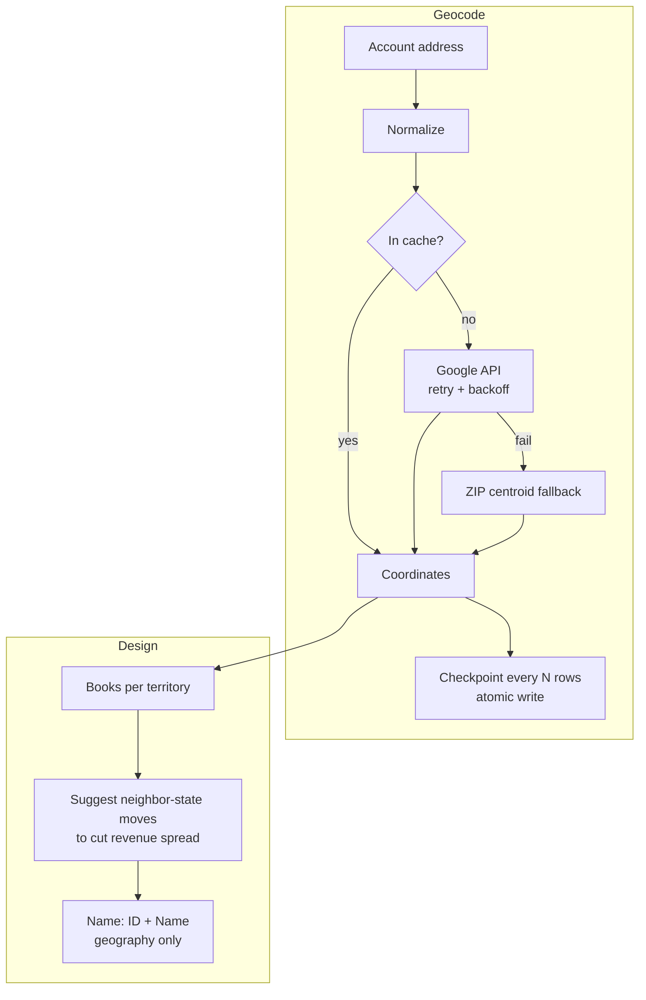

# Territory Optimizer

[](https://github.com/vrutikadani/territory-optimizer/actions/workflows/ci.yml)

A toolkit for designing sales territories: geocoding that survives failures, a naming convention that survives staffing changes, and a balance check that suggests fair state moves. The routing rules that use these territories live in [hubspot-revops-system](https://github.com/vrutikadani/hubspot-revops-system).

> **About this repo.** I redesigned US sales territories and lead routing for a medical device company, using territory-planning software, the Google Maps API and CRM workflows. The production work covered **24 field reps and 12 account managers** and **$7.6M+ in year-to-date territory revenue**. This repo rebuilds the core logic with **synthetic accounts and reps**. No customer, rep or territory data is included.

## The business problem

- Territory labels had rep names baked in ("Temp JORDAN"), so every hire or exit broke reports and workflows.
- Some reps carried far bigger books than others.
- A geocoding job failed halfway through the account list. It had no cache and no checkpoint, so a restart meant paying for every address again, and partial results overwrote good data.

## What's inside



| Module | What it does |
|---|---|
| `territory/geocode.py` | Cache, retry with backoff, checkpoints, atomic writes, ZIP fallback, never overwrite good data |
| `territory/naming.py` | Builds `ID` ("MS, AL, Memphis, Atlanta") and `Name` ("Mississippi, Alabama, Memphis, Atlanta"); lints old labels for rep names, "temp" and airport codes |
| `territory/balance.py` | Revenue and account counts per territory; greedy neighbor-state moves that shrink the max/min spread |

## Run it

```bash
pip install pytest
python run_demo.py       # geocoding, naming and balance on synthetic data
python -m pytest -q      # 7 tests
```

Sample balance output:

```
Balance - spread before: 1.75x
   move TN Southeast -> South Central: spread 1.75x -> 1.55x
   move WA Pacific -> Mountain: spread 1.55x -> 1.29x
   move AL Southeast -> South Central: spread 1.29x -> 1.2x
```

Live geocoding (optional): set `GOOGLE_MAPS_KEY` and use `GoogleProvider` with `CachedGeocoder`.

## Lessons from the geocoding failure

- **Cache first.** An address should cost one API call, ever.
- **Checkpoint.** A crash should lose minutes, not the whole run.
- **Never overwrite good data with a failure.**
- **Say how precise a point is.** A ZIP centroid is fine for territory design, not for drive-time routing.

